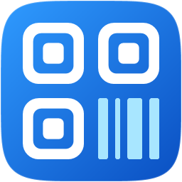
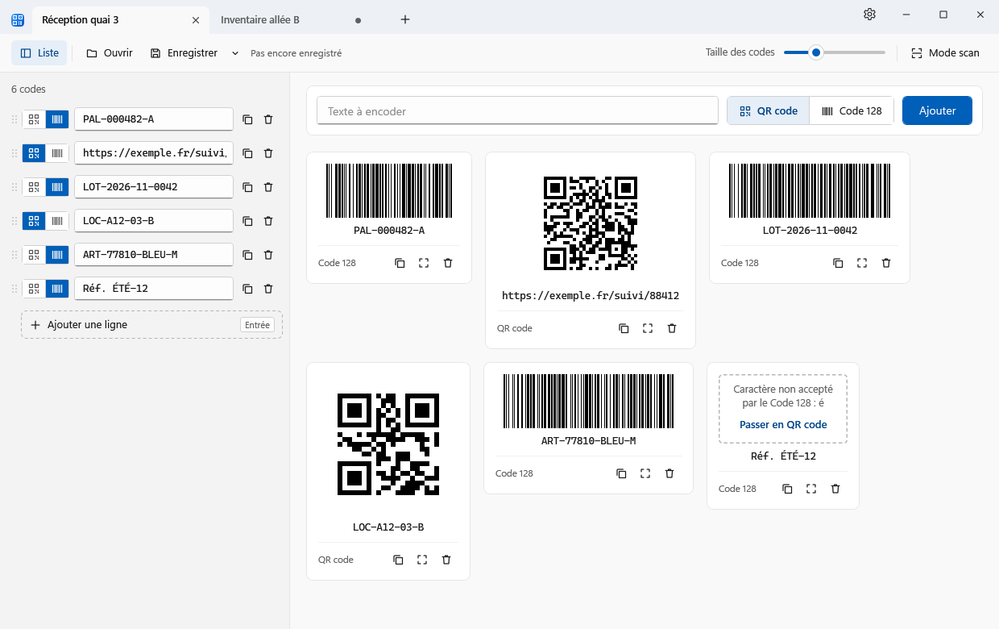
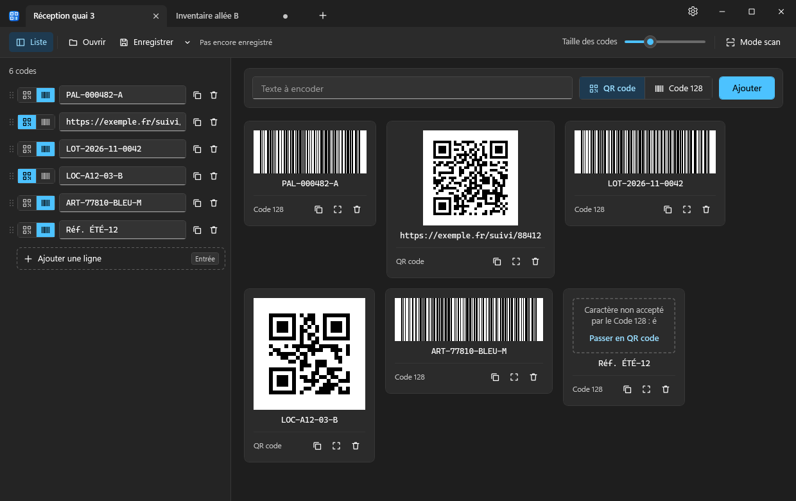
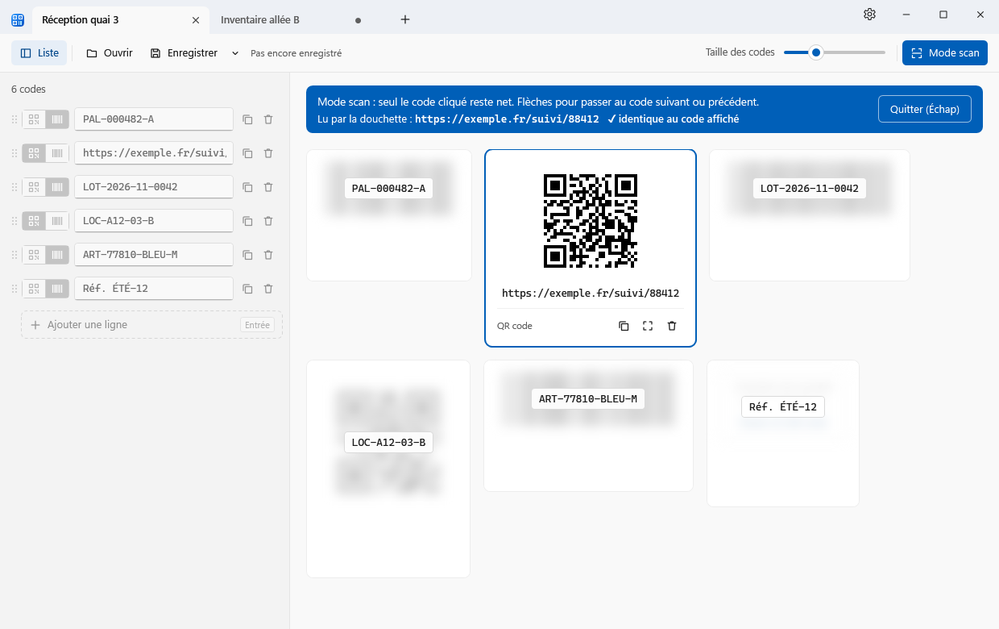

<p align="center">
  
</p>

<h1 align="center">Tableau de code-barres</h1>

<p align="center">
  Un tableau de QR codes et de codes-barres à scanner directement à l'écran.<br>
  Application entièrement locale, conçue pour Windows 11.
</p>

<p align="center">
  <a href="https://github.com/ArbitroDev/BarcodeBoard/releases/latest"></a>
  <a href="https://github.com/ArbitroDev/BarcodeBoard/releases"></a>
  <a href="https://github.com/ArbitroDev/BarcodeBoard/actions/workflows/ci.yml"></a>
  
  
  <a href="LICENSE.md"></a>
</p>

<p align="center">
  <a href="https://github.com/ArbitroDev/BarcodeBoard/releases/latest">Télécharger</a> ·
  <a href="#utilisation">Utilisation</a> ·
  <a href="#licence">Licence</a> ·
  <a href="README.md">English</a>
</p>



## Pourquoi

Tester une douchette, préparer un inventaire, saisir des références dans un ERP sans les
imprimer : Tableau de code-barres affiche vos codes à l'écran, nets au pixel près, prêts à être
lus. Vous tapez un texte, choisissez QR code ou Code 128, et le code apparaît.

## Fonctionnalités

- **QR codes et codes-barres Code 128**, au choix pour chaque code. Les accents passent en QR code ; un caractère que le Code 128 ne sait pas encoder est signalé, avec un bouton pour passer en QR code.
- **Plusieurs codes côte à côte**, réorganisables par glisser-déposer, et une liste latérale redimensionnable pour saisir vite (Entrée crée la ligne suivante).
- **Plusieurs onglets**, renommables par le menu du clic droit, enregistrables dans un fichier `.codes` pour les rouvrir plus tard.
- **Mode scan** : seul le code choisi reste net, les autres sont floutés pour qu'une douchette ne lise jamais le voisin. Le pointeur de la souris s'efface au-dessus du code. Si la douchette est branchée sur le même PC, ce qu'elle lit s'affiche et est comparé au code attendu.
- **Plein écran** pour scanner un code en grand.
- **Copie** de l'image d'un code (pour Word, Outlook, Teams…) ou de son texte, d'un clic.
- **Netteté garantie** : chaque barre fait un nombre entier de pixels de l'écran, avec les marges blanches réglementaires, quelle que soit la mise à l'échelle de Windows.
- **Conçue pour Windows 11** : construite avec WinUI 3, les contrôles natifs de Windows : onglets dans la barre de titre, glissés vers une nouvelle fenêtre ou une autre, matériau Mica, vrais boutons de fenêtre du système, thème clair ou sombre (suit Windows par défaut). Fonctionne aussi sous Windows 10, avec une apparence plus simple.
- **En français ou en anglais**, selon la langue de Windows.
- **Entièrement local** : aucune connexion réseau, aucune télémétrie.

| Thème sombre | Mode scan |
|---|---|
|  |  |

## Installation

Téléchargez la dernière version depuis la page
[Releases](https://github.com/ArbitroDev/BarcodeBoard/releases/latest) :

| Fichier | Pour qui |
|---|---|
| `BarcodeBoard-Setup-x.y.z.exe` | **Recommandé.** Installe l'application pour votre compte, sans droits administrateur : raccourci dans le menu Démarrer, ouverture des fichiers `.codes` par double-clic, désinstallation depuis les Paramètres de Windows. |
| `BarcodeBoard-x.y.z-portable.exe` | Un seul fichier à lancer tel quel, sans installation (clé USB, poste verrouillé). |

Aucun runtime .NET ni Windows App SDK n'est nécessaire : tout est inclus. L'exe portable extrait ses
fichiers d'exécution dans un dossier temporaire à son premier lancement.

> Les fichiers ne sont pas signés numériquement. Au premier lancement, Windows SmartScreen peut
> afficher « Windows a protégé votre ordinateur » : cliquez sur **Informations complémentaires**
> puis **Exécuter quand même**.

Configuration requise : Windows 11 (recommandé, l'application est conçue et adaptée pour lui) ou
Windows 10 (1809 et plus), 64 bits.

## Utilisation

| Action | Comment |
|---|---|
| Ajouter un code | Tapez le texte, choisissez QR code ou Code 128, puis **Entrée** ou **Ajouter** |
| Modifier un code | Cliquez sur sa carte (son texte revient dans la zone de saisie), ou modifiez-le dans la liste |
| Réorganiser | Glissez une carte, ou une ligne de la liste par sa poignée |
| Copier | Bouton copier : l'image du code. Clic sur le texte : le texte |
| Mode scan | **F6** ou bouton Mode scan ; flèches pour changer de code, **Échap** pour quitter |
| Plein écran | Double-clic sur une carte |
| Taille des codes | Curseur de la barre d'outils |
| Onglets | **Ctrl+T** nouveau, **Ctrl+W** fermer (ou clic du milieu), **Ctrl+Tab** suivant, clic droit pour renommer, glisser le long de la barre pour réorganiser |
| Fenêtres | Glissez un onglet hors de la barre d'onglets pour l'ouvrir dans sa propre fenêtre, ou sur la barre d'une autre fenêtre pour l'y regrouper (aussi par clic droit sur l'onglet). Les fichiers `.codes` ouverts depuis l'Explorateur rejoignent la dernière fenêtre utilisée. |
| Fichiers | **Ctrl+O** ouvrir, **Ctrl+S** enregistrer, **Ctrl+Maj+S** enregistrer sous |
| Liste latérale | **Ctrl+L**, et glisser son bord pour la redimensionner |
| Thème | Bouton Paramètres (roue dentée) en haut à droite, ou **Ctrl+,** : comme Windows, clair ou sombre |

### Le fichier `.codes`

Un onglet s'enregistre dans un fichier JSON lisible :

```json
{
  "format": "barcode-board",
  "version": 1,
  "name": "Réception quai 3",
  "codes": [
    { "text": "PAL-000482-A", "type": "code128" },
    { "text": "https://exemple.fr/suivi/88412", "type": "qr" }
  ]
}
```

Les réglages (taille des codes, thème, largeur de la liste, position de la fenêtre) sont
enregistrés dans `%LOCALAPPDATA%\BarcodeBoard\settings.json`.

## Compiler depuis les sources

Prérequis : [SDK .NET 10](https://dotnet.microsoft.com/download) sous Windows. Le Windows App SDK
arrive par un paquet NuGet.

```powershell
dotnet test tests/BarcodeBoard.Core.Tests
dotnet run --project src/BarcodeBoard
dotnet publish src/BarcodeBoard -c Release -o publish
```

L'installeur se construit avec [Inno Setup 6](https://jrsoftware.org/isinfo.php) :

```powershell
& "${env:ProgramFiles(x86)}\Inno Setup 6\ISCC.exe" /DAppVersion=1.0.0 installer\BarcodeBoard.iss
```

Une version se publie en poussant un tag `vX.Y.Z` : le workflow GitHub Actions compile, teste,
construit l'installeur et l'exe portable, puis les attache à la release.

| Dossier | Contenu |
|---|---|
| `src/BarcodeBoard.Core` | Génération des codes (ZXing.Net), calcul des pixels, images des codes (PNG, image du presse-papiers), fichiers `.codes` |
| `src/BarcodeBoard.ViewModels` | Logique de l'application sans interface : onglets, codes, mode scan, règles du clavier, réglages, textes français et anglais (`Loc.cs`) |
| `src/BarcodeBoard` | L'application WinUI 3 (Windows App SDK) |
| `tests/BarcodeBoard.Core.Tests` | Tests du cœur et de la logique de l'application, dont la relecture des codes générés à 100, 125, 150 et 200 % |
| `installer` | Script de l'installeur |
| `tools/IconGen.cs` | Générateur de l'icône (`dotnet run tools/IconGen.cs -- ico K src/BarcodeBoard/Assets`) |

Si le dossier du projet a un chemin très long, la publication peut dépasser la limite de
260 caractères de Windows : publiez alors depuis un dossier au chemin court.

## Contribuer

Les signalements de bugs et les suggestions sont bienvenus dans les
[issues](https://github.com/ArbitroDev/BarcodeBoard/issues). Les pull requests sont acceptées
dans le cadre défini par la licence (section 3) : lisez d'abord le guide
[CONTRIBUTING.md](CONTRIBUTING.md) (en anglais).

## Licence

Tableau de code-barres (Barcode Board en anglais) est un logiciel **à source disponible**, pas un
logiciel libre. En résumé :

- ✅ Vous pouvez l'utiliser gratuitement, à titre personnel comme professionnel, y compris en entreprise, et l'installer sur les postes de votre organisation.
- ✅ Vous pouvez lire le code et proposer des contributions.
- ❌ Vous ne pouvez pas le redistribuer, le vendre, réutiliser son code ou son nom dans un autre produit sans autorisation écrite.

Le texte qui fait foi, en anglais, est dans [LICENSE.md](LICENSE.md). Les composants tiers sont listés dans
[THIRD-PARTY-NOTICES.md](THIRD-PARTY-NOTICES.md).

Copyright (c) 2026 ArbitroDev.
