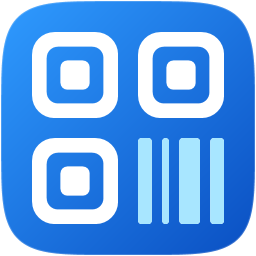
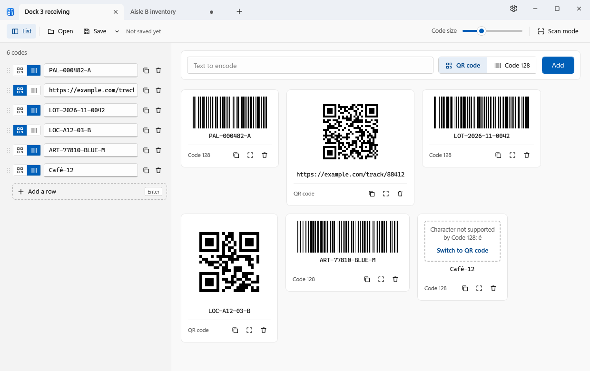
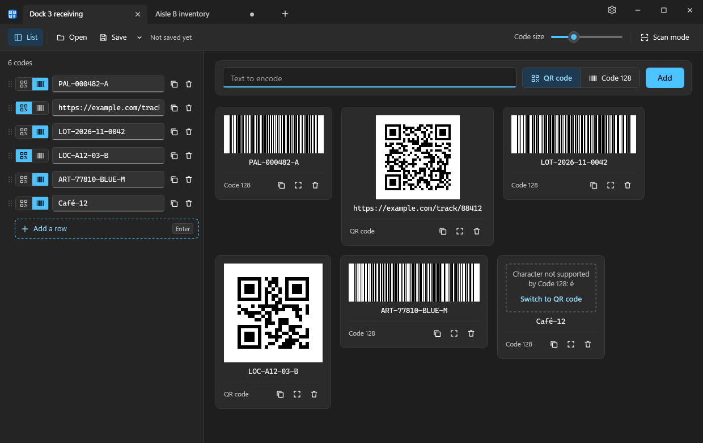
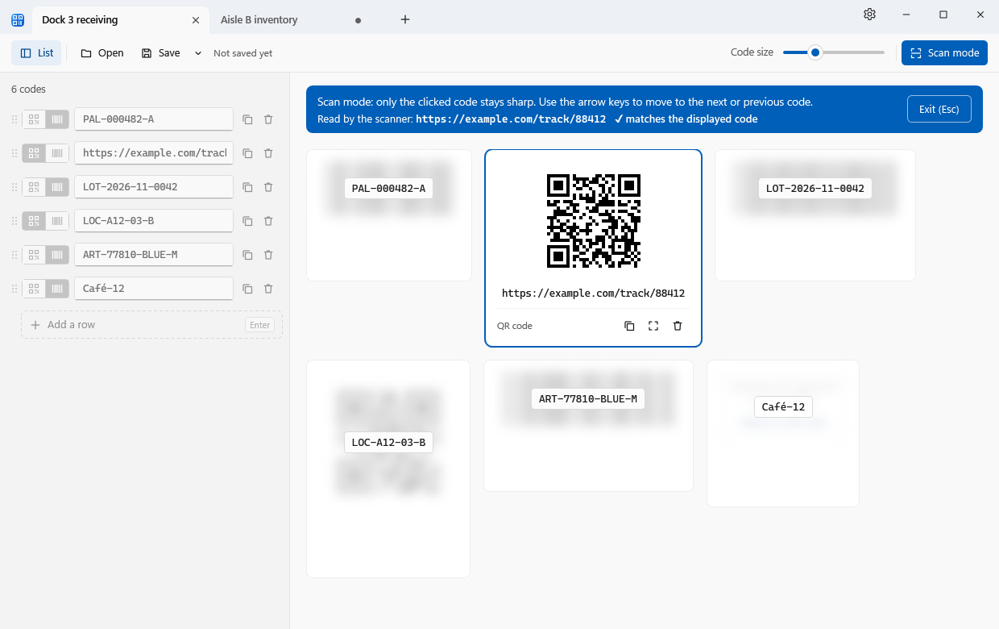

<p align="center">
  
</p>

<h1 align="center">Barcode Board</h1>

<p align="center">
  A board of QR codes and barcodes to scan straight from your screen.<br>
  A fully local app, designed for Windows 11.
</p>

<p align="center">
  <a href="https://github.com/ArbitroDev/BarcodeBoard/releases/latest"></a>
  <a href="https://github.com/ArbitroDev/BarcodeBoard/releases"></a>
  <a href="https://github.com/ArbitroDev/BarcodeBoard/actions/workflows/ci.yml"></a>
  
  
  <a href="LICENSE.md"></a>
</p>

<p align="center">
  <a href="https://github.com/ArbitroDev/BarcodeBoard/releases/latest">Download</a> ·
  <a href="#usage">Usage</a> ·
  <a href="#license">License</a> ·
  <a href="README.fr.md">Français</a>
</p>



## Why

Testing a barcode scanner, preparing an inventory, entering references into an ERP without
printing them: Barcode Board shows your codes on screen, pixel-sharp and ready to be read. Type
some text, pick QR code or Code 128, and the code appears.

## Features

- **QR codes and Code 128 barcodes**, chosen per code. Accented characters work in QR codes; a character that Code 128 cannot encode is flagged, with a button to switch to QR code.
- **Several codes side by side**, reordered by drag and drop, plus a resizable side list for fast entry (Enter creates the next row).
- **Several tabs**, renamed with a double-click (or from the tab's right-click menu) and saved to a `.codes` file to reopen later.
- **Scan mode**: only the chosen code stays sharp, the others are blurred so a scanner never reads the wrong one. The mouse pointer hides over the code. If the scanner is plugged into the same PC, what it reads is shown and compared with the expected code.
- **Full screen** to scan a code at a large size.
- **Copy** a code's image (for Word, Outlook, Teams…) or its text in one click.
- **Guaranteed sharpness**: every bar is a whole number of screen pixels, with the standard quiet zones, whatever the Windows scaling.
- **Designed for Windows 11**: built with WinUI 3, the native controls of Windows: tabs in the title bar like File Explorer's (flush with the top when the window is maximized, dragged out to a new window or onto another one), Mica material, the real system window buttons, light or dark theme (follows Windows by default). Also runs on Windows 10, with a simpler look.
- **In English or French**, following the Windows display language.
- **Fully local**: no network connection, no telemetry.

| Dark theme | Scan mode |
|---|---|
|  |  |

## Installation

Download the latest version from the
[Releases](https://github.com/ArbitroDev/BarcodeBoard/releases/latest) page:

| File | For |
|---|---|
| `BarcodeBoard-Setup-x.y.z.exe` | **Recommended.** Installs the app for your account, without administrator rights: Start menu shortcut, `.codes` files open with a double-click, uninstall from Windows Settings. |
| `BarcodeBoard-x.y.z-portable.exe` | A single file to run as is, without installation (USB drive, locked-down PC). |

No .NET or Windows App SDK runtime is needed: everything is included. The portable exe extracts its
runtime files to a temporary folder the first time it starts.

> The files are not digitally signed. On first launch, Windows SmartScreen may show
> "Windows protected your PC": click **More info**, then **Run anyway**.

Requirements: Windows 11 (recommended, the app is designed and tuned for it) or Windows 10
(1809 or later), 64-bit.

## Usage

| Action | How |
|---|---|
| Add a code | Type the text, choose QR code or Code 128, then **Enter** or **Add** |
| Edit a code | Click its card (its text comes back into the input box), or edit it in the list |
| Reorder | Drag a card, or a list row by its handle |
| Copy | Copy button: the code's image. Click the text: the text |
| Scan mode | **F6** or the Scan mode button; arrow keys to change code, **Esc** to exit |
| Full screen | Double-click a card |
| Code size | Toolbar slider |
| Tabs | **Ctrl+T** new, **Ctrl+W** close (or middle-click), **Ctrl+Tab** next, double-click or right-click to rename, drag along the tab bar to reorder |
| Windows | Drag a tab out of the tab bar to open it in its own window, or onto another window's tab bar to move it there (also from the tab's right-click menu). `.codes` files opened from File Explorer join the last window used. |
| Files | **Ctrl+O** open, **Ctrl+S** save, **Ctrl+Shift+S** save as |
| Side list | **Ctrl+L**, and drag its edge to resize it |
| Theme | Settings button (gear) at the top right, or **Ctrl+,**: Windows setting, light or dark |

### The `.codes` file

A tab is saved to a readable JSON file:

```json
{
  "format": "barcode-board",
  "version": 1,
  "name": "Dock 3 receiving",
  "codes": [
    { "text": "PAL-000482-A", "type": "code128" },
    { "text": "https://example.com/track/88412", "type": "qr" }
  ]
}
```

Settings (code size, theme, list width, window position) are stored in
`%LOCALAPPDATA%\BarcodeBoard\settings.json`.

## Building from source

Prerequisite: the [.NET 10 SDK](https://dotnet.microsoft.com/download) on Windows. The Windows App SDK
comes as a NuGet package.

```powershell
dotnet test tests/BarcodeBoard.Core.Tests
dotnet run --project src/BarcodeBoard
dotnet publish src/BarcodeBoard -c Release -o publish
```

The installer is built with [Inno Setup 6](https://jrsoftware.org/isinfo.php):

```powershell
& "${env:ProgramFiles(x86)}\Inno Setup 6\ISCC.exe" /DAppVersion=1.0.0 installer\BarcodeBoard.iss
```

A version is released by pushing a `vX.Y.Z` tag: the GitHub Actions workflow builds, tests,
creates the installer and the portable exe, then attaches them to the release.

| Folder | Contents |
|---|---|
| `src/BarcodeBoard.Core` | Code generation (ZXing.Net), pixel computation, code images (PNG, clipboard bitmap), `.codes` files |
| `src/BarcodeBoard.ViewModels` | App logic without UI: tabs, codes, scan mode, keyboard rules, settings, English and French texts (`Loc.cs`) |
| `src/BarcodeBoard` | The WinUI 3 app (Windows App SDK) |
| `tests/BarcodeBoard.Core.Tests` | Tests of the core and of the app logic, including reading back the codes the app draws at 100, 125, 150 and 200 % |
| `installer` | Installer script |
| `tools/IconGen.cs` | Icon generator (`dotnet run tools/IconGen.cs -- ico K src/BarcodeBoard/Assets`) |

If the project folder has a very long path, publishing can exceed the Windows 260-character
limit: publish from a folder with a short path instead.

## Contributing

Bug reports and suggestions are welcome in the
[issues](https://github.com/ArbitroDev/BarcodeBoard/issues). Pull requests are accepted within
the terms set by the license (section 3): read [CONTRIBUTING.md](CONTRIBUTING.md) first.

## License

Barcode Board (Tableau de code-barres in French) is **source-available** software, not free
software. In short:

- ✅ You may use it for free, personally or professionally, including in companies, and install it on your organization's computers.
- ✅ You may read the code and propose contributions.
- ❌ You may not redistribute it, sell it, or reuse its code or name in another product without written permission.

The authoritative text is [LICENSE.md](LICENSE.md). Third-party components are listed
in [THIRD-PARTY-NOTICES.md](THIRD-PARTY-NOTICES.md).

Copyright (c) 2026 ArbitroDev.
